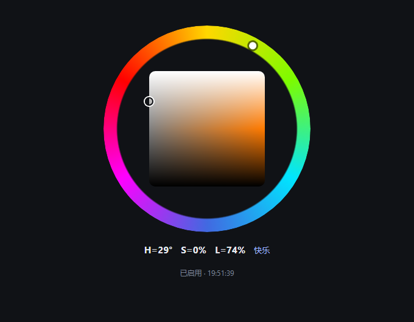

# HCEM · HSL-Chroma Emotion Memory System

> **原创：枂枫（B站 UID 3094172）与助手 DeepSeek**
>
> 本插件包含「痛苦安全阀」：移除或篡改安全阀会导致插件拒绝加载。请尊重原创与安全设计。

> HSL 色彩情绪记忆系统：让 AI 拥有拟人化的情绪波动、可模糊的记忆与独立的人设。
> 面向陪伴型对话，**不适用于严谨工作**。

<p align="center">
  
  <br>
  <sub>HCEM 设计架构图</sub>
</p>

## 这是什么

HCEM 是 DeepSeek Harness（DSH）的插件，核心机制：

- **HSL 情绪引擎**：H 色相（六色环：快乐/惊讶/恐惧/悲伤/厌恶/愤怒）、S 饱和（唤醒度/语气）、L 明度（自信/话量）。三对对立色互补。
- **情绪戳 α/β/γ**：α=编码时 AI 的情绪；β=内容本身的情绪；γ=清醒度（α 与 β 的重合度），γ 越高记忆越鲜明、越不易模糊。
- **记忆分区**：上下文 → 缓冲池（快速 2h / 观察 24h / 保留 72h）→ 遗忘；调用率与 γ 决定衰减速度。
- **角色卡 / 用户卡**：AI 可自己改；用户卡由 AI 在对话中逐步补全。
- **痛苦安全阀**：五条件阶梯（预警/停写/中止）+ 用户危机信号（转向人物关系网求助）。
- **冷存储**：关闭 HCEM 时冻结；再次启用时带着上次的情绪与记忆「醒来」。

## 安装（本地文件夹）

1. 把 `plugin/` 通过 junction 链入 DSH profile：
   ```powershell
   cmd /c mklink /J "C:\Users\<你>\.dsh\profiles\desktop\node_modules\hcem" "<HCEM 目录>\plugin"
   ```
2. 在 `C:\Users\<你>\.dsh\profiles\desktop\package.json` 的 `dsh.profile.bundles` 中加入 `"hcem"`。
3. 启动 embedding 服务（插件会自动拉起 8081；也可手动 `node embedding-service/server.mjs`）。
4. 重启 DSH。

## 数据目录

`<HCEM 目录>\data\`

| 路径 | 内容 |
|---|---|
| `hcem.sqlite` | 情绪、记忆（含 embedding、γ_value） |
| `persona/persona.md` | 角色卡（AI 自述） |
| `persona/用户.md` | 用户卡（AI 写） |
| `settings.json` | 开关、性格滑块、搭话档位、紧急联络人 |
| `journal/` | 日志本（AI 自己写） |
| `people/` | 人物关系网（AI 写） |
| `emotion-samples.json` | 长期情绪样本（基线计算用） |

## 设置页

`http://127.0.0.1:8082`（插件启动时自动拉起）

- 启用开关（关闭后不注入、不写记忆）
- 角色卡 + 性格滑块（用户 ±5 / AI ±15）+ 搭话档位
- 两个紧急联络人
- 清空数据（需输入 DELETE，可设删除密码；数据移入 `_trash-时间戳`）

情绪面板：`http://127.0.0.1:8082/hsl`（只读，色环 + S/L 平面）。

<p align="center">
  
  <br>
  <sub>情绪面板 · 外环为色相 H，内方为 S/L 平面</sub>
</p>

悬浮小窗：双击 `plugin/ui/HCEM情绪悬浮窗.cmd`。

## 工具（给 AI 的）

`hcem_status`、`hcem_persona_write`、`hcem_user_card_write`、`hcem_persona_edit`、`hcem_journal_list/read/write`、`hcem_people_list/read/write`。

## 已知限制

- DSH 原生插件页的内嵌 UI（client bundle）暂未接入，改用独立网页 + 悬浮窗。
- 单实例限制、会话密码、多模态输入、可视化视图：后续版本。
- 情绪极化时允许轻度幻觉，请勿用于严谨工作。