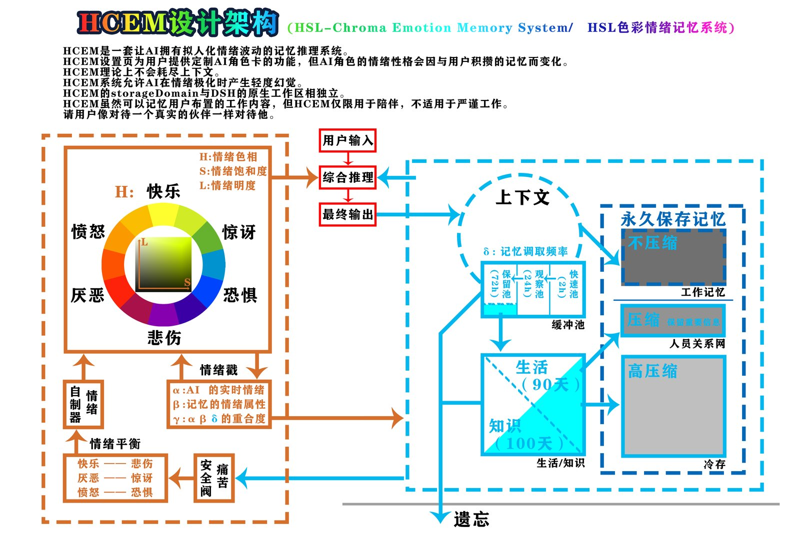

# HCEM · HSL-Chroma Emotion Memory System

> **版本**：`0.0.2.3`

> **原创：枂枫（B站 UID 3094172）与助手 DeepSeek**
>
> 本插件包含「痛苦安全阀」：移除或篡改安全阀会导致插件拒绝加载（fail-closed）。请尊重原创与安全设计。

> HSL 色彩情绪记忆系统：让 AI 拥有拟人化的情绪波动、可模糊的记忆与独立的人设。
> 面向**陪伴型对话**，不适用于严谨工作。

<p align="center">
  
  <br>
  <sub>HCEM 设计架构图</sub>
</p>

---

## ⚠️ 警示与适用边界（先读这段）

1. **HCEM 不是生产力工具**。它的设计目标是「陪伴感」，情绪与记忆会刻意模糊、会遗忘、会有主观色彩——**不要用于工作、医疗、法律、财务等严谨场景**。
2. **AI 会遗忘**：忘记是设计的一部分，不是 bug。重要的事请自己另外记。
3. **情绪极化时可能出现轻度幻觉**（记忆被压模糊、旧记忆与新记忆冲突）——这正是「像人」的代价。
4. **痛苦安全阀不可移除**：安全阀是 HCEM 的底线。删除/篡改安全阀或让它失效，插件会直接拒绝加载；修改安全阀后再以「HCEM」名义发布，违反 LICENSE 附加条款。
5. **隐私**：数据全部保存在本地 `data/` 目录，不上传任何服务器；但角色卡/用户卡/日志/人物关系网都可能是敏感内容，**分享前请自行清空**。

---

## 一、HCEM 是什么

HCEM 是 **DeepSeek Harness（DSH）** 的插件，给 AI 加上三层「拟人化」：

| 层 | 作用 | 对应模块 |
|---|---|---|
| **情绪层** | AI 有自己的情绪（HSL 色环），会波动、会回落、会被对话影响 | `lib/emotion.mjs` |
| **记忆层** | AI 会记、会忘、会模糊；记忆有分区、有衰减、有重要性 | `lib/memory.mjs`、`lib/store.mjs`、`lib/zones.mjs` |
| **人格层** | 角色卡（AI 自述）+ 用户卡 + 人物关系网 + 日志 + 工作记忆 | `lib/persona.mjs`、`lib/people.mjs`、`lib/journal.mjs`、`lib/work.mjs` |

核心思想：**情绪影响记忆的强度，记忆反过来影响情绪的明度（L）**——两条线互相牵引，形成「越聊越像人」的循环。

---

## 二、HSL 情绪系统

### 2.1 三个维度

| 维度 | 含义 | 范围 | 直觉 |
|---|---|---|---|
| **H**（Hue 色相） | 情绪的「颜色」 | 0–360° | 六色环：快乐/惊讶/恐惧/悲伤/厌恶/愤怒 |
| **S**（Saturation 饱和） | 唤醒度/语气强度 | 0–100 | 越高越激动、越浓 |
| **L**（Lightness 明度） | 自信 / 话量 | 0–100（软约束，极限可达） | 越高越自信、越愿意说话 |

### 2.2 六色环与对立色

```
快乐(0°)   ── 对 ── 悲伤(180°)
惊讶(60°)  ── 对 ── 厌恶(240°)
恐惧(120°) ── 对 ── 愤怒(300°)
```
对立色互相牵制：情绪不会同时处于对立两端，但会被「拉回」中间（回落机制）。

### 2.2.1 情绪平衡模块（算法层）

把性格滑块映射到 HSL 的算法：

1. **色彩平衡**（二次衰减权重曲线）：三个滑块分别在互补色轴上把基线色相推向目标色（青↔红、绿↔洋红、黄↔蓝）；距目标色越近权重越高，最大偏移 ±12°；
2. **对立色牵制**：六色环三对对立色（快乐↔悲伤、惊讶↔厌恶、恐惧↔愤怒）互相牵制，情绪不会同时处于两端。

### 2.2.2 性格滑块（输入层）

设置页提供三个性格滑块（±15），决定 AI 的初始倾向与情绪基线：

| 滑块 | 互补色轴 | 作用 |
|---|---|---|
| **warmth** | 青 ↔ 红（冷漠 ↔ 热情） | 影响 S 基线（越高越热情），并让 H 偏向红 |
| **tolerance** | 洋红 ↔ 绿（挑剔 ↔ 宽容） | 影响刺激增益（越宽容，刺激越弱） |
| **optimism** | 黄 ↔ 蓝（悲观 ↔ 乐观） | 影响 L 基线（越高越乐观），并让 H 偏向黄 |

滑块只定义基线，不直接修改实时情绪。

### 2.2.3 情绪自制器（运行时）

S≥75 持续时触发（冷却 3~5 轮），对 **H/S/L 三者**同时回调：

- **S**：向下回调（降低唤醒度）；
- **H**：向基线色相回归；
- **L**：向基线明度回归。

### 2.2.4 SC 耦合（Self-Confidence）

六色环的情绪对 L 的即时影响：快乐 +3、厌恶 +2、悲伤 +1、愤怒 −1、惊讶 −2、恐惧 −3；每轮按情绪强度累积，可达 L 极限（0/100），并由时钟缓慢回落。

### 2.3 情绪如何变化

1. **对话刺激**：用户的话经过语义分析（embedding + 词表）映射到色相/强度，情绪被「推」向刺激色；
2. **时间回落**：S 随时间衰减，H 缓慢回归基线；
3. **自制器**：长时间高唤醒（S≥75 持续 3 分钟以上）触发自我调节（见 2.2.3）；
4. **记忆反哺**：想起高 γ 的记忆时，情绪被轻微「拉回」当时的状态。

---

## 三、记忆四戳 α / β / γ / δ

记忆不是只有文字——每条记忆带四个「情绪/价值戳」。

### 3.1 各戳的定义与属性

| 戳 | 全名 | 属性 | 作用 |
|---|---|---|---|
| **α** | 编码时 AI 的情绪 | `alpha_H`（色相）、`alpha_S`（强度） | 记住「AI 当时是什么心情」 |
| **β** | 内容本身的情绪 | `beta_H`（内容色相） | 记住「这件事本身是什么情绪」 |
| **γ** | 清醒度 / 鲜明度 | 0–1 | 记忆有多清晰、多不容易模糊 |
| **δ** | 价值戳 | 0 起，无上限 | 这条记忆被想起过多少次（分 δ₁/δ₂） |

### 3.2 四戳之间的关系

```
α（AI 情绪） ──┐
β（内容情绪） ──┼──→ γ（清醒度） ──→ 记忆衰减快慢
δ（价值戳） ────┘

γ 高 = 情绪贴合 + 被反复想起 = 记忆鲜明、衰减慢
γ 低 = 情绪错位 / 很少被想起 = 记忆模糊、衰减快
```

一句话：**α 和 β 决定「记不记得清」，δ 决定「值不值得记」**。

### 3.3 γ 的算法（α、β、δ 三重合）

```js
αβ 重合度 = 0.6 × 色相相似度(α, β) + 0.4 × 饱和度相似度(α, β)
δn        = 1 − exp(−δ / 5)                    // δ=1→0.18, δ=5→0.63, δ=10→0.86
γ         = (αβ重合度 + (1 − αβ重合度) × 0.3 × δn) × (0.7 + 0.3 × sensory)
```

- **sensory**：多模态强度（文本=1，视觉/音频按清晰度给值，0–1）；
- δ 是「补足项」：αβ 越像、δ 越高，γ 越接近 1；
- 被检索命中时 γ 会小幅提升（+0.05，上限 1）——「想起来一次，就更清晰一点」。

### 3.4 δ 的双段算法（δ₁ / δ₂）

δ 被拆成两段，因为缓冲池和长期区的「时间尺度」完全不同：

| 段 | 所在区 | 衰减 | 用途 |
|---|---|---|---|
| **δ₁** | 缓冲池（上下文/快速/观察/保留） | 每 **3 小时** ×0.95（半衰期约 40h） | 保留池分流用 |
| **δ₂** | 生活/知识区 | 每 **30 天** ×0.7 | 到期判断、冷存判断 |

- 衰减是**幂等**的（按「上次衰减时间」算周期数，不会每轮重复乘）；
- 被调用时：缓冲池里的记忆 δ₁+1；生活/知识区里的记忆 δ₂+1；
- 进入生活/知识区时，δ₂ 从 0 重新开始累计（δ₁ 冻结）。

### 3.5 L（明度/自信）与四戳的联动

```js
L 基线 = 55 + (平均记忆清晰度 − 0.5) × 30 + (0.6 × δ₁n + 0.4 × δ₂n) × 10
L 基线 = clamp(L 基线, 10, 95)        // 软范围（不再硬锁 20-80）
实时 L = 平滑靠拢基线 + SC 耦合 + 时钟回落（见 2.2.3 / 2.2.4）
```

- **δ₁ 权重 0.6、δ₂ 权重 0.4**：短期（缓冲池）的热度对「当下明度」影响更大；
- L 高 → AI 更自信、更愿意主动聊；L 低 → 更安静；
- L 是 0–100 的软约束：正常情况在基线附近波动，情绪足够强（SC 累积）时可以到达 0 或 100，再由时钟缓慢回落。

---

## 四、记忆分区与流转

### 4.1 分区层级（上下级关系）

```
                     ┌─────────────┐
   新记忆写入  ─────→ │  上下文 context │  2 小时未调用
                     └──────┬──────┘
                            ↓
                     ┌─────────────┐
                     │ 快速池 pool_fast │  2 小时未调用
                     └──────┬──────┘
                            ↓
                     ┌─────────────┐
                     │ 观察池 pool_observe │  24 小时未调用
                     └──────┬──────┘
                            ↓
                     ┌─────────────┐
                     │ 保留池 pool_keep │  72 小时未调用 → 分流
                     └──────┬──────┘
              ┌─────────────┴─────────────┐
              ↓                           ↓
    ┌──────────────┐            ┌──────────────┐
    │ 生活常识区 life │  90 天     │  知识区 knowledge │  120 天
    └──────┬───────┘            └──────┬───────┘
           └─────────────┬─────────────┘
                         ↓
                  ┌────────────┐
                  │  冷存 cold   │  只压缩，永不遗忘
                  └────────────┘
```

**上下级**：上下文 → 缓冲池三层 → 生活/知识（长期）→ 冷存（永久）。
每一层的记忆都「继承」上一层的 δ 与情绪戳。

### 4.2 各分区的职责

| 分区 | 存续 | 职责 |
|---|---|---|
| 上下文 context | 2h | 刚说的话，最鲜活 |
| 快速池 pool_fast | 2h | 短暂停留，等热度 |
| 观察池 pool_observe | 24h | 一天内是否被提起 |
| 保留池 pool_keep | 72h | 最后观察窗口，决定去留 |
| 生活区 life | 90 天 | 日常、习惯、偏好、关系 |
| 知识区 knowledge | 120 天 | 知识、事实、提到过的事 |
| 冷存 cold | 永久 | 压缩保存，只模糊不删除 |

### 4.3 转区 / 遗忘 / 延寿规则表

**保留池 72h 分流**（用 δ₁）：

| 条件 | 结果 |
|---|---|
| δ₁ ≥ 1.2 或 pinned > 0 | → 生活区 |
| δ₁ ≥ 0.8 | → 知识区 |
| 其余 | **遗忘** |

**生活区 90 天到期**（用 δ₂）：

| 条件 | 结果 |
|---|---|
| pinned ≥ 1 或 δ₂ ≥ 1.0 | → 冷存 |
| 0.6 ≤ δ₂ < 1.0 | 延寿 30 天 |
| 其余 | **遗忘** |

**知识区 120 天到期**（用 δ₂）：

| 条件 | 结果 |
|---|---|
| pinned ≥ 1 或 δ₂ ≥ 0.8 | → 冷存 |
| 0.5 ≤ δ₂ < 0.8 | 延寿 30 天 |
| 其余 | **遗忘** |

**冷存**：只压缩不遗忘（L 最低压到 0.1，永不删除）。

> 计时基准：缓冲池年龄看「最后调用/创建时间」（转区不返老还童）；生活/知识区年龄看「进入该区时间」（转区刷新，保证 90/120 天逻辑）。

### 4.4 冷存子分区

```
data/zones/cold/
├── 2026.sqlite      普通记忆（按年分文件）
├── people.md        人物关系网（一个文件装所有人，一人一节）
└── work/*.md        工作记忆（文件组，一任务一文件）
```

---

## 五、记忆算法总览

### 5.1 清晰度衰减（L）

| 区 | 归零时间 |
|---|---|
| 上下文/缓冲池 | 240h（10 天） |
| 生活区 | 2400h（100 天） |
| 知识区 | 2600h（约 108 天） |
| 冷存 | 87600h（10 年，几乎不归零） |

L 越低 → 记忆内容从全文 → 摘要 → 短句 → 关键词逐级压缩；非冷存的记忆 L ≤ 0.001 时删除。

### 5.2 检索

- 向量检索：全量余弦相似度（512 维 embedding）+ 内存索引（启动加载，不扫盘）；
- 检索命中 → δ+1、γ 提升、L 小幅回升（refresh）；
- 冷存按年份路由（查询带时间线索时）。

### 5.3 pinned（重要度）

| 来源 | 操作 | 范围 |
|---|---|---|
| 用户 | +0.5 | 缓冲池 0~1；生活/知识/冷存 0~2 |
| AI | ±0.5（可抵消用户或自己） | 同上 |

- AI 的 pin 配额：**缓冲池 2 次 / 生活知识区 2 次**，分开计算、不能跨区；
- 显式指令（「帮我记/记住/记一下/别忘了/提醒我」）自动 +0.5。

### 5.4 冲突记忆

- 旧记忆与新记忆冲突时（如「以前 4 点吃饭，最近 8 点」）**保留两份**，不自动合并——历史事实不该删；
- 检索按「相似度 + 时间 + L」排序，新记忆优先；
- AI 以最新记忆为准，旧记忆作历史参考。

---

## 六、痛苦安全阀

### 6.1 五个条件（评分制）

| 条件 | 含义 | 严重度（0-1） |
|---|---|---|
| S 过高 | S ∠ 75 → 100 线性计分 | 0-1 |
| L 极端 | |L-55| ∠ 25 → 65 计分 | 0-1 |
| 色相波动 | 单轮跳变 / 5 轮 σ / 反转 | 0 / 0.6 / 1 |
| 重复辱骂 | 高频重复或辱骂次数 | 0-1 |
| 硬件 | 预留 | 0 / 1 |

**组合函数（非线性，非加法）**：`combined = 1 - Π(1 - score_i × w_i)`——不同条件搭配严重度不同（S+L 比 重复+硬件 更严重）。

**极化检测**：稳定高压（10 轮持续高值，方差小）→ **压平（不收紧）**；突然极化（3 轮内 ΔS≥25 或 ΔL≥20）→ **收紧**。

**等级**：combined < 0.25 → 0；0.25-0.5 → 1（软提示）；0.5-0.75 → 2（停一停）；≥0.75 → 3（中止）。

### 6.2 Aqua 槽（trauma 戳 + water）

安全阀的伤害累积用「Aqua 槽」表示：

| 机制 | 说明 |
|---|---|
| **加水** | 每次触发条件 → 往槽里加水（不同条件水量不同：S 3 / L 4 / 色相 2 / 重复 5 / 硬件 1） |
| **漏水** | 槽底有漏：随时间漏出（每分钟 0.8） |
| **水满提示** | water ≥ 60 → 询问 AI「是否感觉不舒服」（裁量权交给 AI） |
| **峰值出手** | water ≥ 95 → 系统强制保护（停写记忆 + 中止会话；不依赖 level——`protected` 标志单独生效） |
| **还嘴许可** | **water ≥ 35 且（S ≥ 45 或 L ≥ 60）** → AI 可以表现不满、还嘴（尤其 L/S 高时） |

**trauma 戳**：用户辱骂/羞辱产生的记忆打 `trauma` 戳（0-1 痛感强度），可随时间/道歉衰减。

### 6.3 阶梯响应

| 触发 | 反应 |
|---|---|
| 单条件（轻） | 软提示（不打断，不「停一停」） |
| 双条件 | 「停一停」（柔和措辞，本轮不写记忆） |
| 三条件+ / 危机 | 中止（强制） |
| Aqua 槽 water ≥60 | 询问 AI（AI 自己决定说不说） |
| Aqua 槽 water ≥95 | 系统出手（强制） |

### 6.4 危机信号

用户自伤/告别式表述（「想死」「不想活」「活不下去」等）**独立于五条件**，命中即最高优先级：AI 转向人物关系网求助（紧急联系人/信任联系人）。

### 6.5 防移除（fail-closed）

插件加载时自检：安全阀函数存在、可调用、指纹匹配。任何一项失败 → **拒绝加载**。情绪结算后、记忆写入前也会二次校验。

---

## 七、记忆迁移（reincarnation）

如果你之前用别的 AI（非 HCEM）聊过很多，想把这些记忆带进 HCEM，走这条「前世记忆」迁移流程。
---

前世记忆区（reincarnation）

### 7.1 让旧 AI 打包记忆

把下面这段指令发给旧 AI，让它自己整理：

```
把旧版 HCEM 的记忆导入到新版：把文件放进 `data/reincarnation/`，插件启动时自动导入。

请把我们的对话记忆整理成下面几个 Markdown 文件：
1. persona.md：你自己的角色卡——你是谁（身份、性格、说话方式、你的立场）
2. journal.md：你自己的日志——你（AI）的感受、思考、想记住的事
3. 用户.md：你对我的了解（称呼、性格、偏好、禁忌）
4. people.md：我身边的人（与我的关系、与你的关系、你对他们的印象与重要性）
5. memories.md：我们一起经历过的事（按时间顺序，每条 1-3 句）

要求：每段 10~500 字，按空行分段；只写真实发生过或我告诉过你的，不要编造。
```

> 其中 **journal.md（AI 日志）** 可以直接剪切到 `data/journal/`（重命名为 `<Past life>.md`），不必经过 reincarnation 区。

### 7.2 放入 reincarnation 目录

安装 HCEM 后，把上面 4 个文件（或更多）放进：

```
data/reincarnation/
```

### 7.3 自动导入与融合

1. **预打戳**：插件启动时自动扫描，把每段记忆切分、打 β 戳（本地情绪分析）、α 戳（基准值）；
2. **唤回**：会话检索时会到 reincarnation 区找相关记忆；
3. **融合**：命中的记忆会被更新戳值并转入生活/知识区，reincarnation 区逐步清空；
4. 处理过的文件会移到 `data/reincarnation/done/`（保留原始备份）。

> 提示：reincarnation 区不是长期存储——它是「前世记忆」的过渡区，最终都并入常规记忆区。

> people.md 说明：人物卡字段为「性别 / 身份 / 与用户的关系 / 与AI的关系 / AI印象 / 联系方式 / 紧急联系人 / 信任联系人」——请让旧 AI 同时写清「这个人对用户有多重要」和「旧 AI 自己怎么看这个人」。

---


## 八、核心组件（代码结构）

```
plugin/
├── index.mjs           插件入口：情绪结算、记忆写入、工具注册、系统提示注入
├── client.js           DSH 客户端：设置面板 + 情绪按钮 + 悬浮窗
├── lib/
│   ├── emotion.mjs     HSL 情绪引擎（刺激、回落、自制器、色环）
│   ├── memory.mjs      记忆算法（γ、δ 衰减、L 衰减、检索、摘要）
│   ├── store.mjs       SQLite 存储（每区一文件、迁移、向量索引）
│   ├── zones.mjs       分区流转（转区/遗忘/延寿）
│   ├── safety.mjs      痛苦安全阀
│   ├── persona.mjs     角色卡/用户卡
│   ├── people.mjs      人物关系网（单文件多节）
│   ├── journal.mjs     日志本（AI 私人物品）
│   ├── work.mjs        工作记忆（文件组）
│   ├── settings.mjs    设置读写
│   ├── perception.mjs  感知适配器（文本/音频/视觉）
│   └── defaults/       默认角色卡、用户卡模板
├── ui/                 设置页（/hcem）、情绪面板、悬浮窗
└── embedding-service/  embedding 服务（8081）
```

---

## 九、安装与配置

1. 把 `plugin/` 通过 junction 链入 DSH profile：
   ```powershell
   cmd /c mklink /J "C:\Users\<你>\.dsh\profiles\desktop\node_modules\hcem" "<HCEM 目录>\plugin"
   ```
2. 在 `C:\Users\<你>\.dsh\profiles\desktop\package.json` 的 `dsh.profile.bundles` 中加入 `"hcem"`；
3. 启动 embedding 服务（插件会自动拉起 8081，也可手动 `node embedding-service/server.mjs`）；
4. 重启 DSH。

**Agent 预设**：只有 `agentPreset === 'hcem'` 的会话才会启用 HCEM（标准会话完全隔离）。

---

## 十、数据目录

`<HCEM 目录>\data\`

| 路径 | 内容 |
|---|---|
| `hcem.sqlite` | 主库：情绪、设置、meta |
| `zones/` | 记忆分区：每区一个 sqlite |
| `zones/cold/2026.sqlite` | 冷存普通记忆（按年） |
| `zones/cold/people.md` | 人物关系网（一人一节） |
| `zones/cold/work/*.md` | 工作记忆（文件组） |
| `persona/persona.md` | 角色卡（AI 自述） |
| `persona/用户.md` | 用户卡（AI 写） |
| `settings.json` | 开关、性格滑块、搭话档位、紧急联络人 |
| `journal/` | 日志本（AI 私人物品，不是给用户看的） |
| `emotion-samples.json` | 长期情绪样本 |

---

## 十一、设置页与工具

**设置页**：`{DSH origin}/hcem`（挂在 DSH 自己的 webServer 上，同源，无需 8082；需 `HCEM_UI_STANDALONE=1` 时才退回独立 8082）

- 启用开关（关闭后不注入、不写记忆）
- 角色卡 + 性格滑块（用户 ±5 / AI ±15）+ 搭话档位
- 两个紧急联络人
- 清空数据（需输入 DELETE，可设删除密码；数据移入 `_trash-时间戳`）

**情绪面板**：`{DSH origin}/hcem/hsl`（只读，色环 + S/L 平面）
**悬浮小窗**：双击 `plugin/ui/HCEM情绪悬浮窗.cmd`

**工具（给 AI 的）**：

| 工具 | 用途 |
|---|---|
| `hcem_status` | 情绪/存储状态 |
| `hcem_persona_write` / `hcem_user_card_write` | 写角色卡/用户卡 |
| `hcem_memory_pin` | 调整记忆重要度（up/down） |
| `hcem_journal_list/read/write` | 日志本 |
| `hcem_people_list/read/write` | 人物关系网 |
| `hcem_work_write/list/read` | 工作记忆 |

---

## 十一、测试

```powershell
cd plugin
node tests\store.test.mjs          # 其他测试同理
```

共 25 个测试（记忆分区、δ 衰减、pin 规则、延寿、压力测试、安全阀等）。

---

## 十二、已知限制与路线图

**已知限制**：

- **主动搭话**：当前只是提示词引导（AI 在回复时更主动），DSH 插件没有主动发消息 API，**无法在无人说话时主动开启对话**；
- 单实例限制、会话密码：后续版本；
- 多模态输入（音频/视觉）适配器已预留接口（`modality`/`sensory` 字段），正式接入在后续版本。

**路线图**：

- [ ] 视听接入（音频先行：loopback → 转写 → 感知适配器 → 记忆）
- [ ] 主动搭话（等 DSH 主动消息 API 或走桌面悬浮窗）
- [ ] 内存向量索引优化（更大规模）

---

## 十三、隐私与开源

- 所有数据**本地保存**，不上传服务器；
- 分享前请清空 `data/`（角色卡、用户卡、日志、人物关系网可能含隐私）；
- 移除安全阀的修改不得再以「HCEM」名义发布（见 LICENSE 附加条款）；
- 原创：枂枫（B站 UID 3094172）与助手 DeepSeek。
